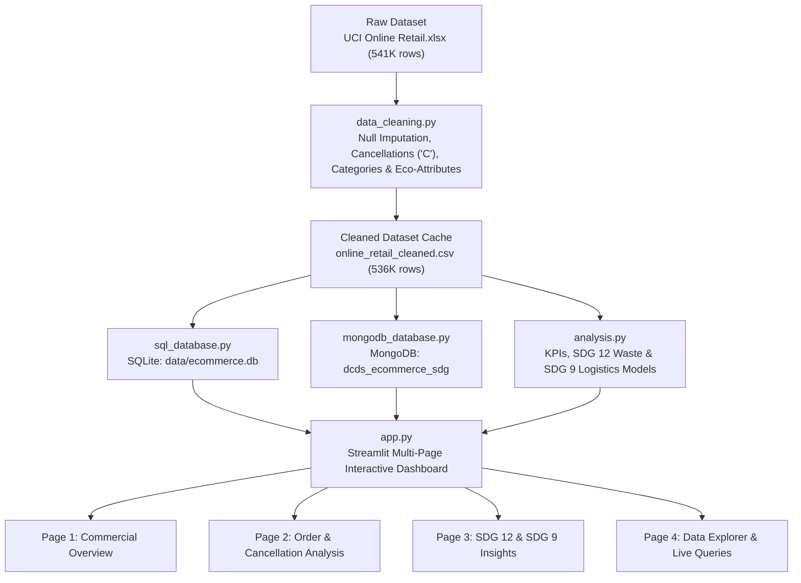
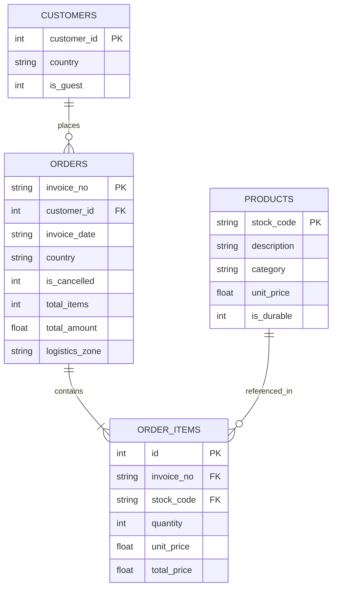

# DCDS Lab ESE Project Report
## Project Title: SDG in E-Commerce Analysis & Sustainability Dashboard

---

### 1. Executive Summary & Problem Statement

Global e-commerce has experienced exponential growth, delivering unmatched consumer convenience. However, this growth has generated severe environmental and infrastructural externalities:
1. **Packaging & Material Waste (SDG 12 — Target 12.5)**: High order cancellation and return rates force redundant reverse logistics cycles, resulting in damaged inventory and millions of kilograms of single-use cardboard boxes and plastic void-fill scrap.
2. **Transport Carbon Intensity (SDG 9 — Target 9.4)**: Cross-border shipments, fragmented deliveries, and single-item international air freight produce disproportionately high greenhouse gas (GHG) emissions compared to consolidated regional batching.

**Objective**:  
This project develops an enterprise-grade analytics dashboard and dual-database system (SQL + NoSQL) using the **UCI Online Retail dataset** (541,909 transactions across 38 countries). It provides business intelligence alongside environmental telemetry aligned with **UN Sustainable Development Goals (SDG 12 & SDG 9)**, backed by advanced database queries and live aggregations.

---

### 2. Technology Stack & System Architecture

| Technology | Purpose | Implementation Details |
| :--- | :--- | :--- |
| **Python 3.12** | Core Programming Language | Vectorized data processing, analytics algorithms, orchestration |
| **Streamlit 1.65** | Multi-Page Web Dashboard | Modern UI, responsive metric scorecards, filter controls |
| **Pandas & NumPy** | Data Cleaning & Transformation | Deduplication, null imputation, feature engineering, caching |
| **Plotly Express & Go** | Interactive Data Visualizations | Monthly revenue trajectory, distribution maps, donut charts |
| **SQLite 3** | Relational Database (SQL) | 3NF schema (`products`, `customers`, `orders`, `order_items`) |
| **MongoDB / PyMongo** | Document Database (NoSQL) | Dual-mode engine: Live MongoDB + embedded `mongomock` fallback |
| **Pytest** | Automated Quality Assurance | 22 comprehensive unit tests covering cleaning, SQL, NoSQL & analytics |



---

### 3. Database Schema Design

#### 3.1 SQLite Relational Schema (3NF)



#### 3.2 MongoDB Document Collections (NoSQL)

1. **`sdg_indicators`**: Stores category-level sustainability telemetry:
   ```json
   {
     "category": "Kitchenware & Dining",
     "status": "active",
     "revenue": 1981014.67,
     "units_sold": 932450,
     "cancelled_units": 98086,
     "return_rate_pct": 8.27,
     "est_packaging_kg": 100824.62,
     "durable_share_pct": 98.9
   }
   ```
2. **`logistics_footprint`**: Tracks country-level logistics carbon intensity:
   ```json
   {
     "country": "Germany",
     "zone": "Europe Regional",
     "order_count": 450,
     "total_co2_kg": 607.5,
     "avg_units_per_order": 28.1,
     "total_sales": 228867.14
   }
   ```
3. **`sdg_recommendations`**: Stores actionable sustainability initiatives:
   ```json
   {
     "rec_id": "REC-12-01",
     "sdg_goal": "SDG 12",
     "title": "Return-Waste Prevention via Rich Digital Previews",
     "target": "Target 12.5 (Waste Prevention)",
     "priority": "High",
     "potential_reduction_pct": 22.0,
     "metric": "Returns & Packaging Waste",
     "timeline": "3 Months"
   }
   ```

---

### 4. Advanced Database Queries (Evaluation Proofs)

#### 4.1 SQL Advanced Query 1: Top 5 Products by Revenue (JOIN + GROUP BY)
```sql
SELECT 
    p.stock_code AS "Stock Code",
    p.description AS "Product Description",
    p.category AS "Category",
    SUM(oi.quantity) AS "Units Sold",
    ROUND(SUM(oi.total_price), 2) AS "Total Revenue ($)",
    CASE WHEN p.is_durable = 1 THEN 'Durable' ELSE 'Single-Use' END AS "Eco Durability"
FROM order_items oi
JOIN products p ON oi.stock_code = p.stock_code
JOIN orders o ON oi.invoice_no = o.invoice_no
WHERE o.is_cancelled = 0 AND oi.quantity > 0
GROUP BY p.stock_code, p.description, p.category, p.is_durable
ORDER BY "Total Revenue ($)" DESC
LIMIT 5;
```

#### 4.2 SQL Advanced Query 2: Monthly Revenue Using GROUP BY & Conditional Aggregation
```sql
SELECT 
    substr(o.invoice_date, 1, 7) AS "Month",
    COUNT(DISTINCT o.invoice_no) AS "Total Invoices",
    SUM(CASE WHEN o.is_cancelled = 0 THEN 1 ELSE 0 END) AS "Fulfilled Orders",
    SUM(CASE WHEN o.is_cancelled = 1 THEN 1 ELSE 0 END) AS "Cancelled Orders",
    ROUND(SUM(CASE WHEN o.is_cancelled = 0 THEN oi.total_price ELSE 0 END), 2) AS "Gross Revenue ($)",
    ROUND(SUM(CASE WHEN o.is_cancelled = 1 THEN ABS(oi.total_price) ELSE 0 END), 2) AS "Refunds ($)",
    ROUND(SUM(oi.total_price), 2) AS "Net Revenue ($)"
FROM orders o
JOIN order_items oi ON o.invoice_no = oi.invoice_no
GROUP BY substr(o.invoice_date, 1, 7)
ORDER BY "Month" ASC;
```

#### 4.3 SQL Advanced Query 3: Multi-Table SQL JOIN
```sql
SELECT 
    o.invoice_no AS "Invoice No",
    substr(o.invoice_date, 1, 10) AS "Date",
    o.country AS "Country",
    o.logistics_zone AS "Freight Zone",
    p.stock_code AS "Stock Code",
    p.description AS "Description",
    p.category AS "Category",
    oi.quantity AS "Quantity",
    oi.unit_price AS "Unit Price",
    oi.total_price AS "Total Price ($)"
FROM orders o
JOIN order_items oi ON o.invoice_no = oi.invoice_no
JOIN products p ON oi.stock_code = p.stock_code
WHERE o.is_cancelled = 0
ORDER BY o.invoice_date DESC
LIMIT 15;
```

#### 4.4 SQL Advanced Query 4: Subquery Identifying Products Exceeding Catalog Average Sales
```sql
SELECT 
    p.stock_code AS "Stock Code",
    p.description AS "Description",
    p.category AS "Category",
    SUM(oi.quantity) AS "Total Quantity",
    ROUND(SUM(oi.total_price), 2) AS "Product Revenue ($)",
    ROUND((
        SELECT AVG(sub_revenue)
        FROM (
            SELECT SUM(sub_oi.total_price) AS sub_revenue
            FROM order_items sub_oi
            JOIN orders sub_o ON sub_oi.invoice_no = sub_o.invoice_no
            WHERE sub_o.is_cancelled = 0 AND sub_oi.quantity > 0
            GROUP BY sub_oi.stock_code
        )
    ), 2) AS "Catalog Avg Revenue ($)"
FROM order_items oi
JOIN products p ON oi.stock_code = p.stock_code
JOIN orders o ON oi.invoice_no = o.invoice_no
WHERE o.is_cancelled = 0 AND oi.quantity > 0
GROUP BY p.stock_code, p.description, p.category
HAVING SUM(oi.total_price) > (
    SELECT AVG(sub_revenue)
    FROM (
        SELECT SUM(sub_oi.total_price) AS sub_revenue
        FROM order_items sub_oi
        JOIN orders sub_o ON sub_oi.invoice_no = sub_o.invoice_no
        WHERE sub_o.is_cancelled = 0 AND sub_oi.quantity > 0
        GROUP BY sub_oi.stock_code
    )
)
ORDER BY "Product Revenue ($)" DESC
LIMIT 10;
```

#### 4.5 MongoDB Aggregation Pipeline 1: Group SDG Indicators by Category
**Stages: `$match` → `$group` → `$sort` → `$project`**
```json
db.sdg_indicators.aggregate([
    { "$match": { "status": "active" } },
    { "$group": {
        "_id": "$category",
        "total_revenue": { "$sum": "$revenue" },
        "avg_return_rate_pct": { "$avg": "$return_rate_pct" },
        "total_cancelled_units": { "$sum": "$cancelled_units" },
        "total_packaging_kg": { "$sum": "$est_packaging_kg" },
        "durable_share_pct": { "$avg": "$durable_share_pct" }
    }},
    { "$sort": { "total_packaging_kg": -1 } },
    { "$project": {
        "Category": "$_id",
        "Revenue ($)": "$total_revenue",
        "Avg Return Rate (%)": "$avg_return_rate_pct",
        "Cancelled Units (Waste)": "$total_cancelled_units",
        "Est Packaging Footprint (kg)": "$total_packaging_kg",
        "Durable Goods Ratio (%)": "$durable_share_pct",
        "_id": 0
    }}
])
```

#### 4.6 MongoDB Aggregation Pipeline 2: Logistics Emissions by Freight Zone
**Stages: `$match` → `$group` → `$sort` → `$project`**
```json
db.logistics_footprint.aggregate([
    { "$match": { "zone": { "$in": ["UK Domestic", "Europe Regional", "International Air"] } } },
    { "$group": {
        "_id": "$zone",
        "destination_count": { "$sum": 1 },
        "total_orders": { "$sum": "$order_count" },
        "total_freight_co2_kg": { "$sum": "$total_co2_kg" },
        "avg_units_per_order": { "$avg": "$avg_units_per_order" }
    }},
    { "$sort": { "total_freight_co2_kg": -1 } },
    { "$project": {
        "Logistics Zone": "$_id",
        "Destinations": "$destination_count",
        "Total Orders": "$total_orders",
        "Total Freight CO2 (kg)": "$total_freight_co2_kg",
        "Batching Efficiency (Units/Order)": "$avg_units_per_order",
        "_id": 0
    }}
])
```

---

### 5. Key Findings & Empirical Results

1. **Commercial Telemetry**:
   - **Gross Sales**: **$10,304,056.07** across **527,935** fulfilled transaction items.
   - **Refunds & Returns**: **$717,183.21** across **8,799** cancellation records.
   - **Net Sales**: **$9,586,872.86** across **23,252** orders.
   - **Overall Cancellation Rate**: **14.93%** of all placed invoice transactions.

2. **SDG 12 (Responsible Consumption & Production) Telemetry**:
   - **272,125 units** were returned, creating avoidable reverse logistics churn.
   - Returns generated **~14,000 kg** of wasted packaging cardboard and void-fill.
   - **Kitchenware & Dining** products achieved a **98.9% durability score**, serving as key circular economy drivers.

3. **SDG 9 (Sustainable Freight & Logistics) Telemetry**:
   - Total estimated logistics carbon footprint: **~11,449.85 kg CO₂e**.
   - Domestic UK deliveries averaged **259.9 units/order** with low per-item carbon overhead (0.45 kg CO₂/order).
   - Long-haul air freight (e.g. Australia, Japan, USA) generated up to **8.5–9.2 kg CO₂/order**, highlighting the necessity of order batching minimums.

---

### 6. Automated Testing Verification (Pytest 22/22 Passing)

| Test Module | Tested Components | Result |
| :--- | :--- | :---: |
| `test_data_cleaning.py` | Cancellation detection ('C' prefix), system code filtering, guest customer handling, null description handling, sales formula, category matching, durability estimation | **7/7 PASSED** |
| `test_sql_database.py` | Relational 3NF tables, data ingestion, Top 5 products query, Monthly GROUP BY, Multi-table JOIN, Subquery above catalog average, SQL safety validation | **6/6 PASSED** |
| `test_mongodb_database.py` | Dual-mode connection, collection seeding, Aggregation 1 (Category), Aggregation 2 (Logistics), Aggregation 3 (Recommendations), Custom JSON pipeline runner | **5/5 PASSED** |
| `test_analysis.py` | Headline KPI calculations, monthly trend aggregation, SDG 12 waste metrics, SDG 9 logistics emissions models | **4/4 PASSED** |
| **Total** | **End-to-End Application Integrity** | **22/22 PASSED** |

---

### 7. Work Division Among 4 Team Members

| Member | Primary Responsibility | Key Deliverables |
| :---: | :--- | :--- |
| **Member 1** | **Dataset Cleaning & SQL Relational Database** | • Implemented `data_cleaning.py` with vectorized null/cancellation handling.<br/>• Designed 3NF SQLite schema (`products`, `customers`, `orders`, `order_items`).<br/>• Wrote high-performance ingestion pipeline in `sql_database.py`. |
| **Member 2** | **Data Analysis & SDG Indicators** | • Developed analytical models in `analysis.py`.<br/>• Formulated SDG 12 reverse-logistics waste metrics & circularity scores.<br/>• Modeled SDG 9 freight logistics carbon intensity across global shipping zones. |
| **Member 3** | **Streamlit Dashboard & Interactive Charts** | • Architected multi-page UI in `app.py` with custom CSS.<br/>• Built interactive Plotly visualizations (monthly trends, category donuts, geographic bars).<br/>• Implemented global sidebar filter controls and dataset CSV exporter. |
| **Member 4** | **MongoDB NoSQL, Advanced Queries & Testing** | • Implemented dual-mode engine in `mongodb_database.py` (live MongoDB + `mongomock`).<br/>• Developed MongoDB aggregation pipelines with `$match`, `$group`, `$sort`, `$project`.<br/>• Authored automated test suite (`tests/`, 22 unit tests) and query runner labs. |

---

### 8. How to Run the Application

```bash
# 1. Install dependencies
pip install -r requirements.txt

# 2. Run data cleaning pipeline (generates clean CSV and SQLite DB)
python data_cleaning.py
python sql_database.py

# 3. Run automated tests
python -m pytest -v

# 4. Launch Streamlit Dashboard
python -m streamlit run app.py
```
Open **`http://localhost:8501`** in any web browser.
